# Mathis

Environnement et agents de Mathis. Voir le [contrat](../../CONTRACT.md) pour le problème et les critères.

## Où j'en suis

| Phase | Validée | Taux de réussite | Précision (médiane) | Vitesse au contact | Algorithme |
|---|---|---|---|---|---|
| 0 | | | | | |

Référence à battre, le contrôleur PD écrit à la main (graines d'évaluation 10 000 à 10 099) :

| Phase | Taux de réussite | Précision (médiane) | Vitesse au contact | Inclinaison au contact |
|---|---|---|---|---|
| 0 | 100 % | 0,38 m | −0,63 m/s | 1,5° |
| 1 | 100 % | 1,1 m | −0,64 m/s | 2,3° |

## Avancement de l'environnement

| Étape | Contenu | État |
|---|---|---|
| 1 | Scène MuJoCo : mer, barge, fusée | ✅ |
| 2 | Moteur : poussée et tuyère | ✅ |
| 3 | Enveloppe Gymnasium : espaces, `reset`, `step`, fins d'épisode | ✅ |
| 4 | Récompense, vérifiée avec un contrôleur PD de référence | ✅ |
| 5 | Premier apprentissage (phase 0 facilitée, puis complète) | en cours : v1 à v4 échouent, voir le journal |

## Journal visuel

Captures rangées dans [`docs/captures/<etape>/`](docs/captures/), régénérées avec `uv run python -m rocket_mathis.capture etape-N`.

### Étape 1 : la scène (20/11/2026)

| Fusée posée | Vue d'ensemble | Descente |
|---|---|---|
|  |  |  |

### Étape 2 : le moteur (20/11/2026)

| Vol stationnaire | Tuyère à 10° | Bascule après 1,5 s |
|---|---|---|
| 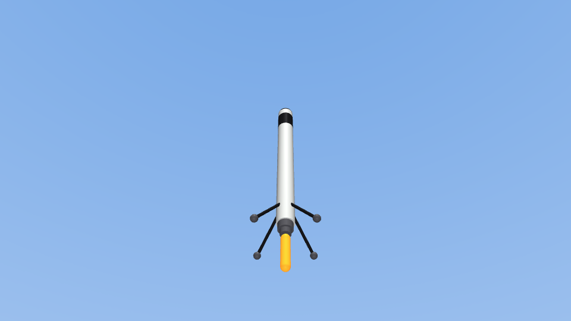 | 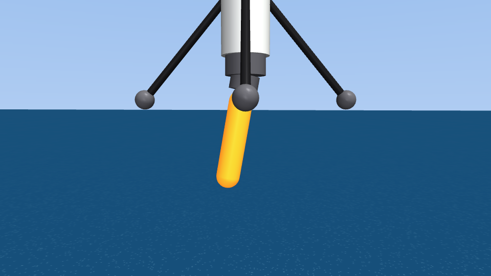 | 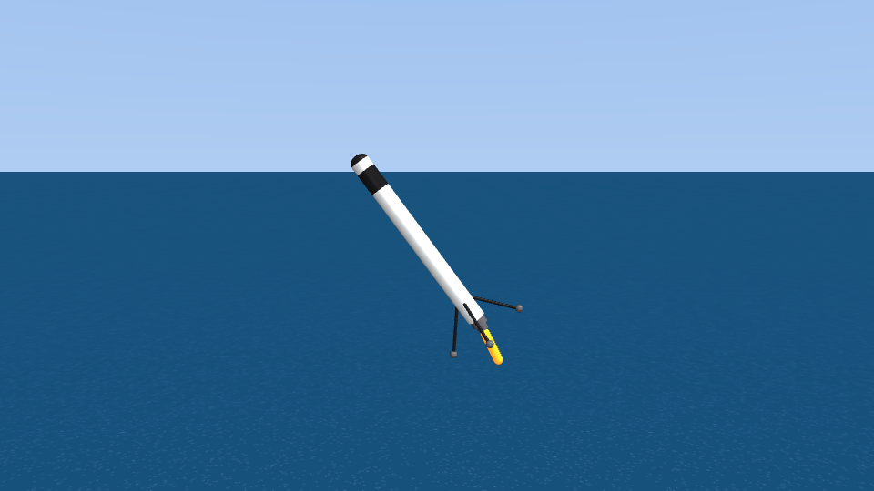 |

### Étape 3 : l'environnement (20/11/2026)

| 8 départs du contrat, poussée = poids, sans pilotage : tous échouent | Moteur coupé : crash |
|---|---|
| 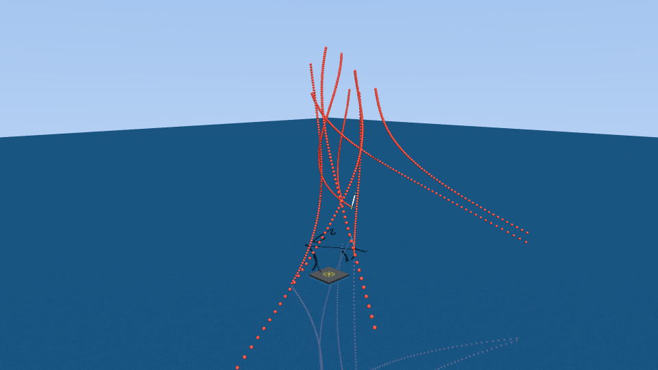 | 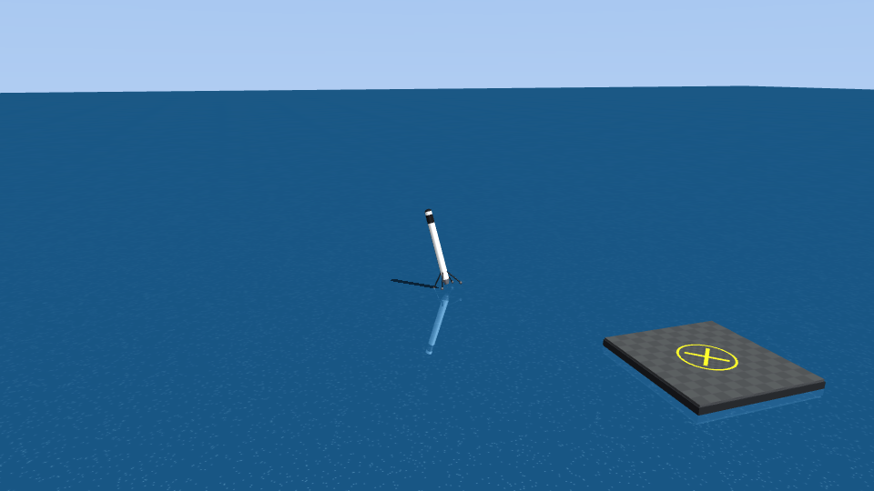 |

### Étape 4 : récompense et contrôleur PD (20/11/2026)

| Mêmes 8 départs, avec le PD : tous posés | Approche (40 m) | Arrondi (8 m) | Posée |
|---|---|---|---|
| 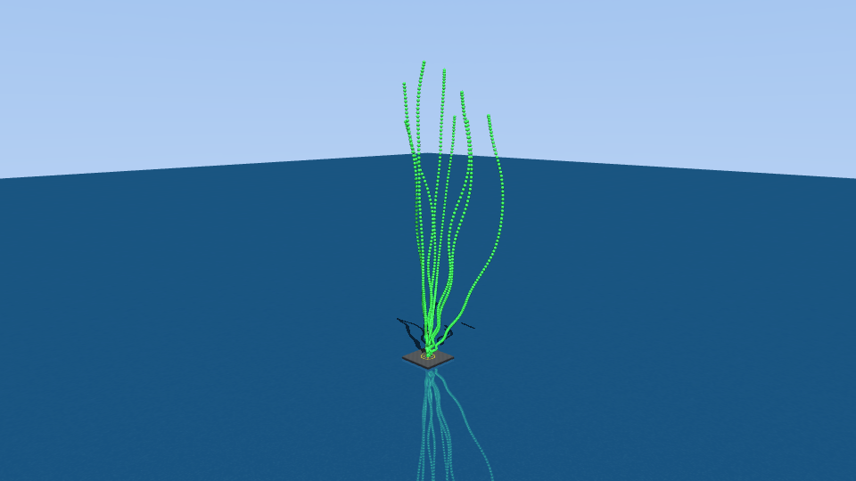 | 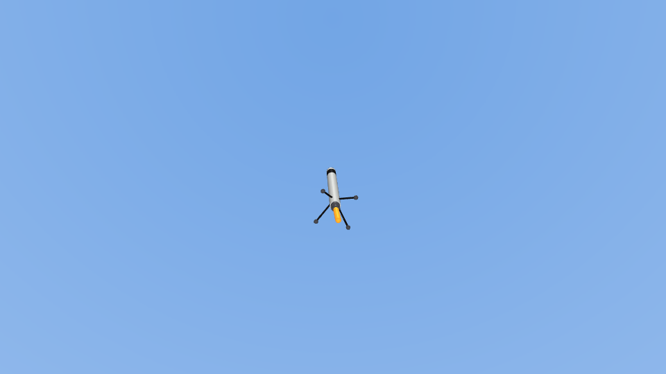 | 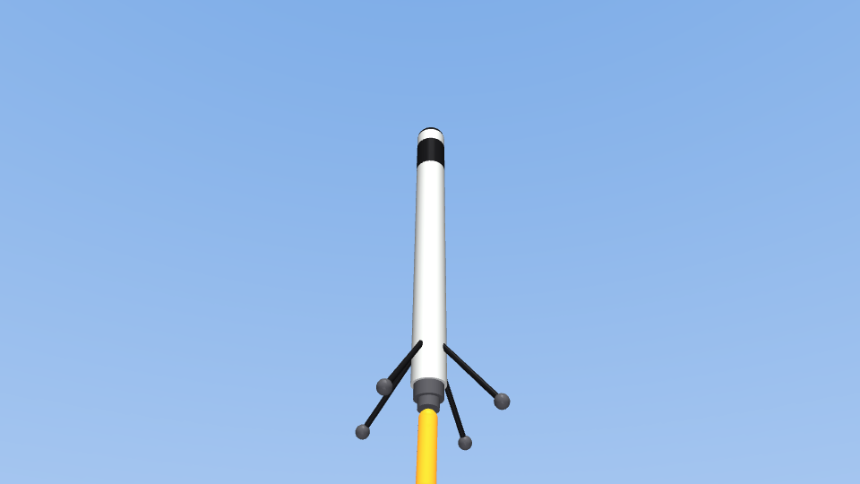 | 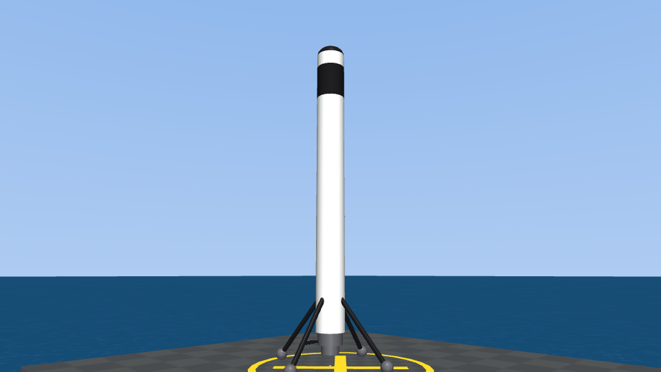 |

### Correctif phase 1 : barge mobile (20/11/2026)

| Le PD suit la barge qui dérive (trace bleue) | Posée sur la barge en mouvement |
|---|---|
| 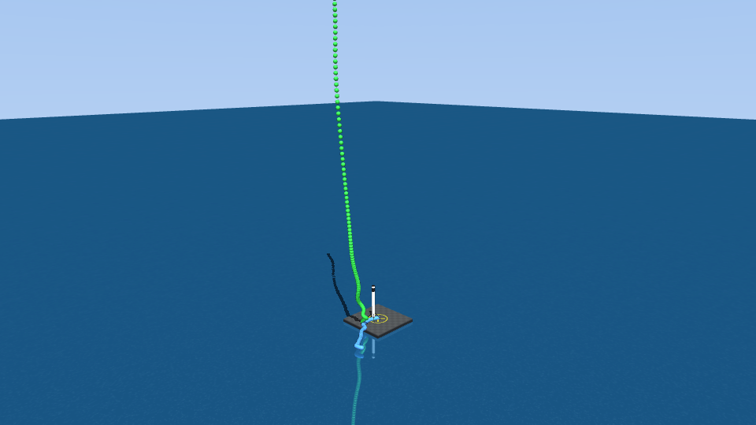 | 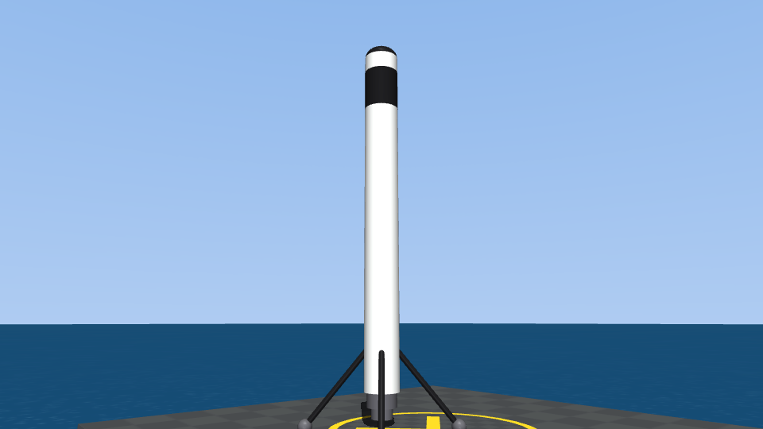 |

### Étape 5 : ce que les agents apprennent quand l'environnement est mal conçu (20/11/2026)

Chaque version de l'environnement se reproduit avec `--variant` (voir `VARIANTS` dans [`config.py`](src/rocket_mathis/config.py)). Les mesures portent sur 20 épisodes au niveau facile, celui de l'entraînement.

| Version | Défaut | Ce que l'agent a appris | Issues |
|---|---|---|---|
| v1 | départ « facile » à 15–25 m, pas de coupure du moteur | planer vers 15 m sans toucher le pont | PPO : 75 % temps écoulé, 25 % hors zone. SAC : 85 / 15 % |
| v2 | Φ = 0 forcé en fin d'épisode | partir loin à basse altitude : sortir de la zone « encaisse » +\|Φ\| | 65 % hors zone, 35 % temps écoulé |
| v3 | pas de coupure du moteur : posée, la fusée glisse à l'eau | fuir le pont, puis basculer | 95 % hors zone |
| v4 | rester en l'air ne coûte rien, curriculum par paliers | PPO : 74 % posées au niveau 0, puis effondrement à 0 % au palier 0,1. SAC : se pose parfois, plane souvent | PPO : 0 %. SAC : 20–25 % posées |

| v1 : PPO plane | v1 : SAC plane | v2 : PPO part au loin |
|---|---|---|
|  | 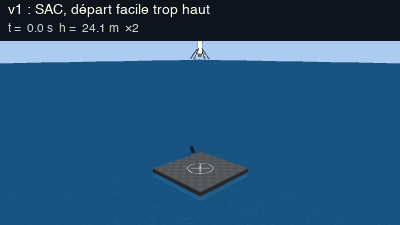 | 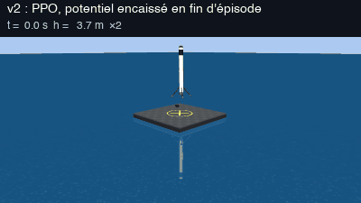 |

| v3 : PPO fuit et bascule | v4 : PPO après l'effondrement | v4 : SAC se pose, puis plane |
|---|---|---|
| 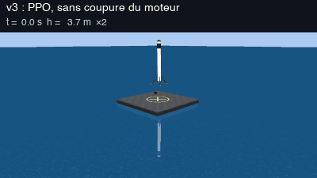 | 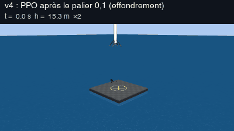 | 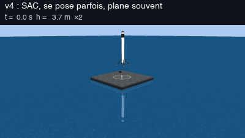 |

| Référence : le PD se pose depuis un départ du contrat |
|---|
| 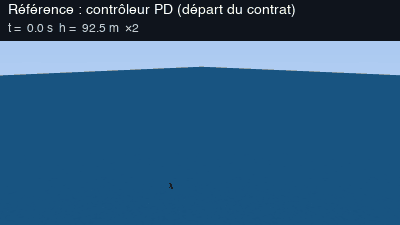 |

À retenir :
- Tant qu'un essai raté coûte −100 et qu'attendre ne coûte rien, l'agent apprend à ne rien tenter : planer ou fuir.
- Un guidage mal borné en fin d'épisode (v2) devient une source de points à exploiter.
- L'agent doit pouvoir **découvrir** le succès par hasard au début, sinon il n'apprend jamais à se poser (v1, v3).
- Un curriculum par paliers peut faire **oublier** ce qui était acquis (v4, PPO).

## Lancer

```bash
uv run python -m mujoco.viewer --mjcf players/mathis/src/rocket_mathis/assets/scene.xml   # menu Key : petite_chute, descente
uv run pytest players/mathis
# environnement : gymnasium.make("rocket_mathis/RocketLanding-v0", config=EnvConfig(phase=0))
uv run python -m rocket_mathis.train --algo ppo --variant v4 --steps 3000000   # entraînement (ppo ou sac)
uv run python -m rocket_mathis.evaluate pd --phase 0   # évaluation du contrat (pd ou random)
uv run python -m rocket_mathis.video <modèle.zip> --variant v4 --difficulty 0 --out <fichier.gif>   # GIF
```

## Notes

### Étape 1 : la scène ([`scene.xml`](src/rocket_mathis/assets/scene.xml))

- Fusée : un corps rigide libre, 1 000 kg (réservoir 700, moteur 200, jambes 4 × 25). Centre de masse 1,5 m sous le milieu.
- Seuls les 4 pieds doivent toucher le pont, tout autre contact sera un crash.
- Barge : position imposée par le code, prête pour la phase 1 (voir le correctif de la phase 1).
- Pas de 2 ms : pose stable sur 4 pieds, redressement après un contact incliné. 5 s simulées ≈ 15 ms.

### Étape 2 : le moteur ([`engine.py`](src/rocket_mathis/engine.py))

- `Engine.apply(data, poussée, tuyère)` en unités physiques (N, rad), bornées par le contrat (19 620 N, ± 10°). À appeler avant chaque `mj_step`.
- Poussée appliquée au pivot de la tuyère, 3,85 m sous le centre de masse : une tuyère positive fait tourner la fusée autour de −x ou −y.
- Vérifié : vol stationnaire à T = m·g, +1 g à pleine poussée, couple conforme au calcul.
- Piège MuJoCo : pour orienter la tuyère et la flamme à la volée, il faut remettre `geom_sameframe` à 0.

### Étape 3 : l'environnement ([`env.py`](src/rocket_mathis/env.py), [`config.py`](src/rocket_mathis/config.py))

- `RocketLandingEnv(MujocoEnv)`, enregistré sous `rocket_mathis/RocketLanding-v0`. Tous les paramètres du contrat sont dans `EnvConfig` (`phase=1` : barge mobile).
- Observation de 21 valeurs, action de 3 valeurs dans [−1, 1] : détail en tête de `env.py`. Une action nulle donne poussée = poids.
- Position mesurée au bas des pieds : altitude 0 = posée.
- Fins d'épisode du contrat dans `info["outcome"]`, avec la vitesse et l'inclinaison au premier contact.
- `check_env` passe, même graine = même épisode. Environ 1 600 pas/s sur un cœur, après avoir sorti du sous-pas le calcul de la direction de poussée et du décor.

### Étape 4 : récompense et PD ([`baseline_pd.py`](src/rocket_mathis/baseline_pd.py), [`evaluate.py`](src/rocket_mathis/evaluate.py))

- Récompense du MDP : guidage `γ·Φ(s') − Φ(s)` avec Φ = 0 en fin d'épisode, puis +100 (+50 au centre) ou −100. Poids et γ = 0,995 dans `EnvConfig`, détail dans `info["reward_terms"]`.
- Vérifié en test : la somme actualisée du guidage vaut exactement −Φ(s0). Le guidage ne favorise donc aucune trajectoire.
- PD : vitesse de descente proportionnelle à l'altitude, PD horizontal qui donne l'inclinaison voulue, PD d'attitude qui donne la tuyère. Il ne lit que l'observation.
- Le PD réussit 100 % en phase 0, contre 0 % au hasard (retour moyen 244 contre −4).
- Correction de l'environnement : « pied posé » = moins de 1 cm du pont, et non plus un contact strict. Sinon, une fusée posée droite sur 3 pieds, le quatrième à 2 mm, n'était jamais déclarée posée.

### Correctif phase 1 : la barge mobile

- La barge n'est plus un `mocap`, qui se téléportait sans que le frottement entraîne la fusée. C'est maintenant un corps de 1 000 t sur deux glissières, dont la vitesse est imposée à chaque sous-pas. Elle est déclarée après la fusée, pour que `qpos[0:7]` reste la fusée.
- La vitesse visée suit le processus d'Ornstein-Uhlenbeck, tiré une fois par décision. La barge la rejoint avec une accélération ≤ 0,5 m/s². Sans cette limite, le bruit tiré tous les 2 ms donnait des à-coups de plus de 20 m/s² qui renversaient la fusée posée.
- Le PD passe de 31 % (puis 11 %) à 100 % en phase 1.

