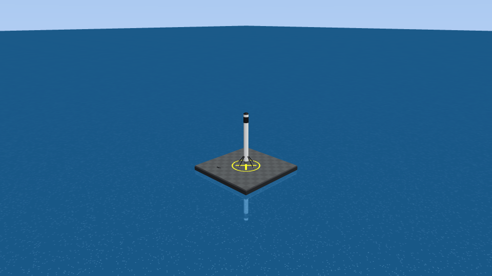
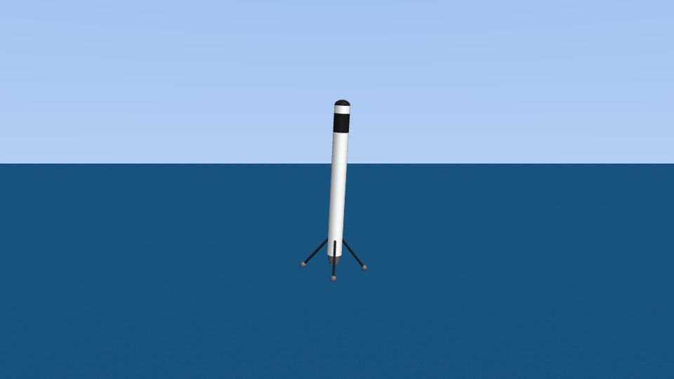

# Mathis

Environnement et agents de Mathis. Voir le [contrat](../../CONTRACT.md) pour le problème et les critères.

## Où j'en suis

| Phase | Validée | Taux de réussite | Précision (médiane) | Vitesse au contact | Algorithme |
|---|---|---|---|---|---|
| 0 | | | | | |

## Avancement de l'environnement

| Étape | Contenu | État |
|---|---|---|
| 1 | Scène MuJoCo : mer, barge, fusée | ✅ |
| 2 | Moteur : poussée et tuyère | |
| 3 | Enveloppe Gymnasium : espaces, `reset`, `step`, fins d'épisode | |
| 4 | Récompense, vérifiée avec un contrôleur PD de référence | |
| 5 | Premier apprentissage (phase 0 facilitée, puis complète) | |

## Journal visuel

Captures prises au fil des étapes, rangées dans [`docs/captures/<etape>/`](docs/captures/). Pour régénérer celles d'une étape : `uv run python -m rocket_mathis.capture etape-1`.

### Étape 1 : la scène (20/11/2026)

| Fusée posée sur la barge | Vue d'ensemble | Pendant la descente |
|---|---|---|
|  |  |  |

## Lancer

```bash
# voir la scène (menu « Key » : petite_chute ou descente, puis double-clic pour suivre la fusée)
uv run python -m mujoco.viewer --mjcf players/mathis/src/rocket_mathis/assets/scene.xml
uv run pytest players/mathis   # tests de la scène
# entraînement :
# évaluation (graines 10 000 à 10 099) :
```

## Notes

### Étape 1 : la scène ([`assets/scene.xml`](src/rocket_mathis/assets/scene.xml))

- **Fusée** : un seul corps rigide avec une articulation libre (6 degrés de liberté). Réservoir de 700 kg, moteur de 200 kg tout en bas, 4 jambes de 25 kg. Total 1 000 kg, conforme au contrat. Le moteur lourd place le centre de masse 1,5 m sous le milieu du réservoir. Inertie calculée par MuJoCo : 11 632 kg·m² en tangage et en lacet, 336 kg·m² en roulis.
- **Jambes** : un bras (capsule) et un pied (sphère). Seuls les pieds doivent toucher le pont : un contact du bras, du réservoir ou du moteur sera un crash. Écartement de 2,1 m depuis l'axe. Au repos, l'origine de la fusée est à 7,1 m (pont à 1 m, puis 6,1 m jusqu'au bas des pieds).
- **Barge** : un corps `mocap`, dont la position est imposée par le code et que la physique ne pousse pas. Pour la phase 1, il suffira de modifier `data.mocap_pos`. Pont de 15 × 15 m dont la surface est à 1 m au-dessus de la mer, avec une cible jaune au centre.
- **Mer** : un plan en z = 0. Un contact avec la mer est un échec.
- **Physique** : pas de 2 ms avec l'intégrateur `implicitfast`. Des contacts légèrement amortis jouent le rôle des amortisseurs des jambes. Vérifié en test :
  - une chute de 2 m ou un contact à 2 m/s : la fusée se pose sur ses 4 pieds sans rebond ni enfoncement ;
  - un contact incliné de 6° : elle se redresse en moins d'une seconde ;
  - un contact incliné de 15° : elle oscille environ 6 s avant de se stabiliser.
  - 5 s simulées prennent environ 15 ms, ce qui laisse de la marge pour l'entraînement. Le pas peut monter à 5 ms sans perdre en stabilité.
- **Points de repère** pour la suite : le site `moteur` (sortie de tuyère, là où s'appliquera la poussée) et le site `centrale` (là où l'état sera mesuré).
- **Caméras** : `large` (vue d'ensemble), `pont` (vue depuis le bord de la barge), `suivi` (suit la fusée).
