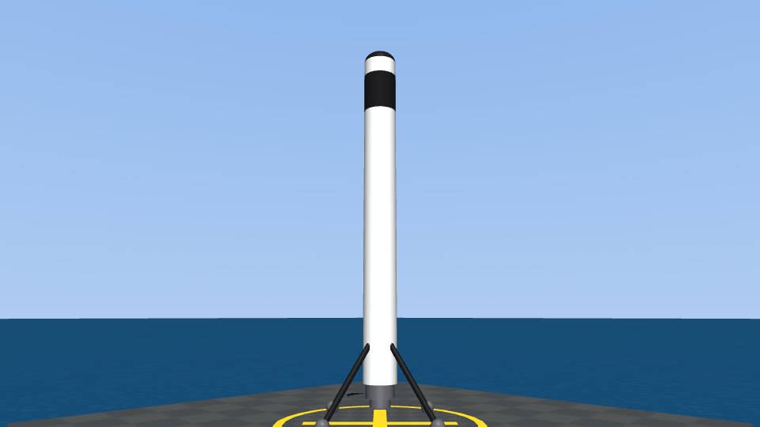

# Mathis

Environnement et agents de Mathis. Voir le [contrat](../../CONTRACT.md) pour le problème et les critères.

## Où j'en suis

| Phase | Validée | Taux de réussite | Précision (médiane) | Vitesse au contact | Algorithme |
|---|---|---|---|---|---|
| 0 | | | | | |

## Avancement de l'environnement

| Étape | Contenu | État |
|---|---|---|
| 1 | Scène MuJoCo : mer, barge, fusée | ✅ |
| 2 | Moteur : poussée et tuyère | ✅ |
| 3 | Enveloppe Gymnasium : espaces, `reset`, `step`, fins d'épisode | |
| 4 | Récompense, vérifiée avec un contrôleur PD de référence | |
| 5 | Premier apprentissage (phase 0 facilitée, puis complète) | |

## Journal visuel

Captures rangées dans [`docs/captures/<etape>/`](docs/captures/), régénérées avec `uv run python -m rocket_mathis.capture etape-N`.

### Étape 1 : la scène (20/11/2026)

| Fusée posée | Vue d'ensemble | Descente |
|---|---|---|
|  |  |  |

### Étape 2 : le moteur (20/11/2026)

| Vol stationnaire | Tuyère à 10° | Bascule après 1,5 s |
|---|---|---|
|  |  |  |

## Lancer

```bash
uv run python -m mujoco.viewer --mjcf players/mathis/src/rocket_mathis/assets/scene.xml   # menu Key : petite_chute, descente
uv run pytest players/mathis
# entraînement :
# évaluation (graines 10 000 à 10 099) :
```

## Notes

### Étape 1 : la scène ([`scene.xml`](src/rocket_mathis/assets/scene.xml))

- Fusée : un corps rigide libre, 1 000 kg (réservoir 700, moteur 200, jambes 4 × 25). Centre de masse 1,5 m sous le milieu.
- Seuls les 4 pieds doivent toucher le pont, tout autre contact sera un crash.
- Barge `mocap` : position imposée par le code (`data.mocap_pos`), prête pour la phase 1.
- Pas de 2 ms : pose stable sur 4 pieds, redressement après un contact incliné. 5 s simulées ≈ 15 ms.

### Étape 2 : le moteur ([`engine.py`](src/rocket_mathis/engine.py))

- `Engine.apply(data, poussée, tuyère)` en unités physiques (N, rad), bornées par le contrat (19 620 N, ± 10°). À appeler avant chaque `mj_step`.
- Poussée appliquée au pivot de la tuyère, 3,85 m sous le centre de masse : une tuyère positive fait tourner la fusée autour de −x ou −y.
- Vérifié : vol stationnaire à T = m·g, +1 g à pleine poussée, couple conforme au calcul.
- Piège MuJoCo : pour orienter la tuyère et la flamme à la volée, il faut remettre `geom_sameframe` à 0.
